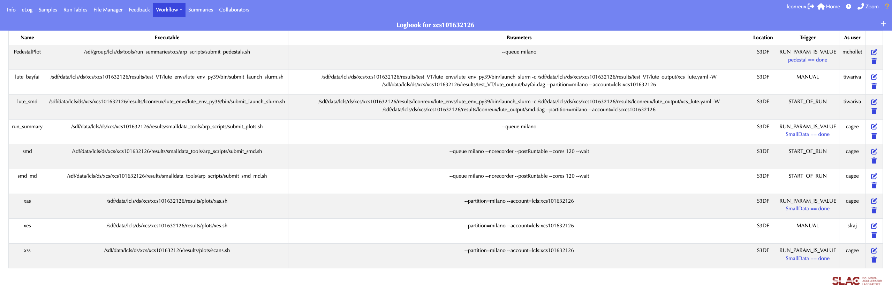
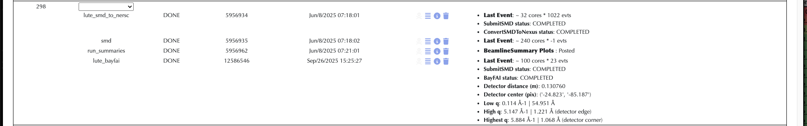
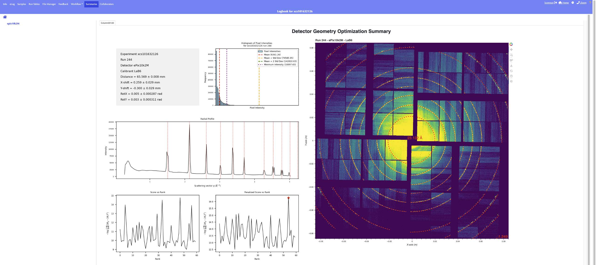

# Running BayFAI

<a name="toc"></a> **Jump to:**

- [`Overview`](#overview)
- [`Setting up BayFAI`](#setting-up-bayfai)
- [`Getting the Calibration Powder`](#getting-the-calibration-powder)
- [`BayFAI Parameters`](#bayfai-parameters)
- [`BayFAI Hyperparameters`](#bayfai-hyperparameters)
- [`MPI ranks and Convergence`](#mpi-ranks-and-convergence)
- [`MEC 4 Quads particularity`](#mec-4-quads-particularity)
- [`Running BayFAI from the eLog`](#running-bayfai-from-the-elog)
- [`To go further: Azimuthal Integration after BayFAI`](#to-go-further-azimuthal-integration-after-bayfai)

---
## Overview

BayFAI calibrates the detector geometry (`dist`, `poni1`, `poni2`, `rot1`, `rot2`, `rot3`) from a powder image of a known calibrant (AgBh, LaB6, CeO2...). It couples [pyFAI](https://pyfai.readthedocs.io) geometry refinement with Bayesian Optimization (BO) to search for the geometry that best fits the calibrant rings.

The `bayfai` workflow runs two managed `Task`s:

1. `SmallDataProducer` (`SubmitSMD`): sums the run into a powder image stored in the smalldata HDF5 file.
2. `BayFAIOptimizer` (`BayFAI`): fits the geometry on that powder and writes the `.poni`, `.geom` and `.data` files.

## Setting up BayFAI

`setup_lute` needs an active Kerberos ticket to create the eLog workflow. Check with `klist`, and run `kinit` if you don't have one.

```bash
/sdf/group/lcls/ds/tools/lute/dev/lute/utilities/setup_lute -e <experiment> -fi -D <folder> -W bayfai
```

- `-fi`: fresh install of LUTE in the experiment folder (optional but recommended).
- `-D <folder>`: put everything in `/sdf/data/lcls/ds/<hutch>/<experiment>/results/<folder>/` (optional but recommended).
- `-W bayfai`: copy the `bayfai` workflow definition. **At MEC use `-W bayfai_mec`** (see [MEC 4 quads particularity](#mec-4-quads-particularity)).

The script will ask for partition, account, nodes and ntasks. Press Enter to accept the defaults. The resources used by each `Task` are then set per hutch: `BayFAIOptimizer` runs on 1 node with 120 tasks.

After setup you will find, in `results/<folder>/lute_output/`:

- `<hutch>_lute.yaml`: the configuration file to edit (see the sections below).
- `bayfai.dag` (or `bayfai_mec.dag`): the workflow definition.

The script also creates an eLog workflow, `lute_bayfai`, with a manual trigger.

## Getting the Calibration Powder

BayFAI needs a powder image, which is produced by `smalldata_tools`. In `<hutch>_lute.yaml`, under `SubmitSMD` > `producer_parameters`:

1. Set `detnames` to the detector(s) used for the calibration run.
2. **Make sure `detSumAlgos` is enabled** and includes `calib_max` (preferred) or `calib`.

BayFAI reads the powder from `Sums/<detname>_calib_max` in the smalldata HDF5 file. If that key is missing it falls back to `Sums/<detname>_calib`. If neither exists, BayFAI fails.

```yaml
SubmitSMD:
  #directory: "{{ work_dir }}/smd_output"
  producer_parameters:
    detnames: ["jungfrau"]
    detSumAlgos:
      all:
        - "calib"
        - "calib_max"
```

Optionally, set `directory` to write the smalldata file somewhere other than the experiment `hdf5` folder. You don't need to tell BayFAI where the file is: its `h5` parameter is filled in automatically from the `SubmitSMD` result.

## BayFAI parameters

Scroll down to the `BayFAI` section of the YAML. At minimum, fill in `detname`, `calibrant` and a rough `center`:

```yaml
BayFAI:
  parallelized: "dist"
  fixed:
  - "rot1"
  - "rot2"
  - "rot3"
  center:
    dist: 0.1               # Fill this section with rough estimates
    poni1: 0.0
    poni2: 0.0
    rot1: 0.0
    rot2: 0.0
    rot3: 0.0
  calibrant: "AgBh"           # Fill this line with calibrant name (AgBh, LaB6...)
  detname: "jungfrau"         # Fill this line with detector name (epix10k2M, jungfrau...)
```

| Parameter | Default | Description |
|---|---|---|
| `detname` | `""` | Detector name as defined in psana (`jungfrau`, `epix10k2M`, `jungfrau4M`, `Epix10kaQuad0`...). |
| `calibrant` | `""` | pyFAI calibrant name, e.g. `AgBh`, `LaB6`, `CeO2` ([list of calibrants](https://github.com/silx-kit/pyFAI/tree/main/src/pyFAI/resources/calibration)). |
| `center` | `dist: 0.1`, others `0.0` | Initial guess geometry. BayFAI searches around it. Distances in m, rotations in rad. |
| `bounds` | `dist: ±0.01`, `poni1/2: ±0.0025`, `rot1/2/3: ±0.1` | Search range around `center` for each parameter. |
| `resolutions` | `dist: 0.001`, `poni1/2: 0.0001`, `rot1/2/3: 0.02` | Grid step of the search space for each parameter. |
| `fixed` | `["rot3"]` | Parameters kept at their `center` value. `rot3` should always be fixed, because the rings don't change under rotation around the beam axis. Also fix `rot1`/`rot2` if the detector is normal to the beam. |
| `parallelized` | `None` | Geometry parameter to spread across MPI ranks (usually `"dist"`). See [MPI ranks and convergence](#mpi-ranks-and-convergence). Can't also be in `fixed`. |
| `wavelength` | `1e-10` | Wavelength in m. If you change it from the default, it overrides the mean photon energy read from the HDF5 file. |
| `h5` | `""` | Smalldata HDF5 file. Filled in automatically from `SubmitSMD`. |
| `out_file` | `""` | Output `.data` file. Defaults to `<work_dir>/geom/<run>-end_<detname>.data`. |

Double-check `center.dist`, `calibrant` and `detname` before each calibration run, since they often change between runs.

## BayFAI hyperparameters

The defaults work for most cases. To override them, add a `bayfai_params` block under `BayFAI`:

```yaml
BayFAI:
  ...
  detname: "jungfrau"
  bayfai_params:
    n_samples: 20
    n_iterations: 80
    pts_per_deg: 1.0
    max_rings: 10
    Imin: 90
```

Overriding defaults will affect significantly convergence and/or compute time.

| Hyperparameter | Default | Description |
|---|---|---|
| `n_samples` | `20` | Number of initial random samples used to initialize the Gaussian Process. |
| `n_iterations` | `80` | Number of BO iterations. Increase it for a larger search space. |
| `max_rings` | `8` | Maximum number of calibrant rings used to extract Bragg peaks. |
| `pts_per_deg` | `2.0` | Number of control points extracted per azimuthal degree along each ring. |
| `Imin` | `95` | Intensity percentile threshold for peak detection. Lower it for weak rings. |
| `prior` | `true` | If `true`, initial samples are drawn around the center of the search space; otherwise they are drawn uniformly. |
| `beta` | `1.96` | Exploration/exploitation trade-off of the Upper Confidence Bound acquisition function. Higher values mean more exploration. |
| `step` | `5` | Size (in grid steps) of the refinement space around the best BO parameters. |
| `lbda` | `0.1` | Penalty weight in the final score used to select the winning geometry across ranks. |
| `seed` | `None` | Random seed, for reproducibility. |

## MPI ranks and Convergence

BayFAI runs one BO per MPI rank.

With `parallelized: "dist"`, each rank gets its own fixed distance on a sliding window centred on `center.dist` and spaced by `resolutions.dist`. The rank then optimizes the other parameters at that distance. The best geometry across all ranks wins.

**The more ranks (CPUs) you give BayFAI, the more of the search space it explores, and the better the chance that BO converges to the right geometry. The trade-off is that the job takes longer and waits longer in the queue.** The default of 120 tasks on one node is a good compromise.

## MEC 4 Quads particularity

At MEC, the detector is made of 4 independent quads (`Epix10kaQuad0` to `Epix10kaQuad3`), and each quad needs its own geometry. The `bayfai_mec` workflow uses a `!param_sweep` with `zip: true` to run one BayFAI per quad, each with its own `detname`, `center` and `fixed`:

```yaml
- !param_sweep
  task_name: BayFAIOptimizer
  zip: true
  param_matrix:
    detname: ["Epix10kaQuad0", "Epix10kaQuad1", "Epix10kaQuad2", "Epix10kaQuad3"]
    fixed:
      - ["rot1", "rot3"]
      - ["rot1", "rot3"]
      - ["rot2", "rot3"]
      - ["rot2", "rot3"]
    center:
      - {dist: 0.27, poni1: 0.06, poni2: 0.06, rot1: 0.0, rot2: -0.6, rot3: 0.0}
      - {dist: 0.27, poni1: 0.08, poni2: -0.04, rot1: 0.0, rot2: -0.6, rot3: 0.0}
      - {dist: 0.2, poni1: -0.01, poni2: 0.0, rot1: 1.1, rot2: 0.0, rot3: 0.0}
      - {dist: 0.1, poni1: -0.01, poni2: 0.04, rot1: -0.4, rot2: 0.0, rot3: 0.0}
    next: []
```

This specification reflects MEC's standard configuration, thus it should not be touched unless one Quad presents a clear deviance from the standard configuration.

**At MEC we don't parallelize over distance anymore:** `parallelized` is left unset, and all ranks run BO over the same full search space. More ranks still means more exploration.

## Running BayFAI from the eLog

1. Check that the `lute_bayfai` workflow exists under __Workflow__ > __Definition__.

|  |
|:-------------------------------------------------------------------------:|
|       __BayFAI workflow definition on eLog for xcs1016322126__       |

2. Double-check whether the distance, the calibrant or the detector changed since the last run:
    ```bash
    nano /sdf/data/lcls/ds/<hutch>/<experiment>/results/<folder>/lute_output/<hutch>_lute.yaml
    ```

3. Go to __Workflow__ > __Control__ and trigger `lute_bayfai` for the calibration run.

4. Monitor the results (after a few minutes):
    - The geometry and the resolution coverage are reported in the eLog.
    - Inspect the fit under __Summaries__ > __Geometry_Fit__ > __r0000__ > __detname__.
    - Fitting plots and BayFAI metrics are written to `lute_output/figs/`.
    - The calibrated geometry files are written to `lute_output/geom/`:
    ```bash
    ls lute_output/geom
    <run>-end_<detname>.data            # Calibrated psana .data geometry
    r<run:0>4>_<detname>.geom           # Calibrated CrystFEL .geom geometry
    r<run:0>4>_<detname>.poni           # PyFAI PONI parameters relative to metrology (origin: center of detector)
    r<run:0>4>_<detname>_image.poni     # PyFAI PONI parameters relative to det.image (origin: top-left pixel)
    ```

|  |
|:------------------------------------------------------------------------------:|
|       __BayFAI geometry report from LaB6 run on eLog for xcs1016322126 run 244.__       |

|  |
|:-------------------------------------------------------------------------------:|
|    __BayFAI summary plots on eLog for xcs1016322126 run 244.__    |

## To go further: Azimuthal Integration after BayFAI

The `r<run:0>4>_<detname>.poni` file produced by BayFAI can be used directly by `smalldata_tools` to azimuthally integrate the data of the following runs. This uses the `azav_lclsgeom` function, which relies on [LCLSGeom](https://github.com/slac-lcls/LCLSGeom).

**The `r<run:0>4>_<detname>.poni` file only makes sense relative to a detector metrology.** It does not describe pixel positions. It holds 6 parameters (`dist`, `poni1`, `poni2`, `rot1`, `rot2`, `rot3`) that place a pyFAI detector in the lab frame. Where each pixel lies within that detector comes from the metrology:

- **Template metrology:** BayFAI builds its pyFAI detector from the LCLSGeom template metrology of the detector, i.e. the nominal panel layout with no prior calibration.
- **Detector frame:** the fitted `.poni` is therefore expressed in the frame of that template detector. `poni1`/`poni2` are measured from its origin, and the rotations are applied about its axes.
- **Assembled geometry:** BayFAI also writes `r<run:0>4>_<detname>_image.poni`, the same fit re-expressed for the assembled `det.image` frame. The assembled image has no z component and snaps pixels to an integer grid, which distorts signal.

**To keep the semantics right, the integration must rebuild the exact same detector with LCLSGeom.** That is what `azav_lclsgeom` does: it calls `get_geometry(<detname>)` followed by `PsanaToPyFAI.convert(...)`, which is the same path BayFAI takes. It then applies the `.poni` on top. As a bonus, pixels are mapped to physical coordinates only once, at initialization, so no 2D image is assembled at each event. Don't pass a BayFAI `.poni` to `azav_pyfai`: that function assembles an image with psana's geometry, which is a different metrology.

The function takes the following parameters:

| Parameter | Default | Description |
|---|---|---|
| `poni_file` | `None` | Path to the BayFAI `.poni` file. Either this or `ai_kwargs` is required. |
| `ai_kwargs` | `None` | Explicit geometry (`dist`, `poni1`, `poni2`, `rot1`, `rot2`, `rot3`, `wavelength`) instead of a `.poni` file. |
| `npts` | `256` | Number of radial bins. |
| `npts_az` | `360` | Number of azimuthal bins (2D only). |
| `int_units` | `"2th_deg"` | Radial unit: `q_A^-1`, `2th_deg` or `r_mm`. `q_A^-1` requires a wavelength in the `.poni` file. |
| `return2d` | `false` | Return a 2D (q, phi) map instead of a 1D profile. |
| `polarization_factor` | `-1` | Polarization factor (vertical by default). |
| `userMask` | `None` | User mask (1 for valid pixels), combined with the detector mask. |
| `thres` | `None` | Pixels below this intensity are set to 0. |
| `azav_kwargs` | `{}` | Extra arguments passed to pyFAI `integrate1d`/`integrate2d`. |

LCLSGeom is only available when `smalldata_tools` runs through LUTE, so run your smalldata workflow with LUTE (e.g. `setup_lute -W smd`). In `<hutch>_lute.yaml`, add `getAzIntLCLSGeomParams` under `SubmitSMD` > `producer_parameters`. LUTE renders it as `getAzIntLCLSGeomParams(run)` for the LCLS1 producer and as `get_azav_lclsgeom(run)` for the LCLS2 producer:

```yaml
SubmitSMD:
  producer_parameters:
    detnames: ["jungfrau"]
    getAzIntLCLSGeomParams:
      jungfrau:
        poni_file: "/sdf/data/lcls/ds/<hutch>/<experiment>/results/<folder>/lute_output/geom/r0012_jungfrau.poni"
        npts: 512
        npts_az: 36
        int_units: "q_A^-1"
        return2d: true
```

Your `smalldata_tools` clone must include PR #274. Older producers don't look for this function and silently skip it.

The azimuthal profiles are then saved per event in the smalldata HDF5 file, under `<detname>/lclsgeom_azav` (with the radial axis stored in `UserDataCfg`).
